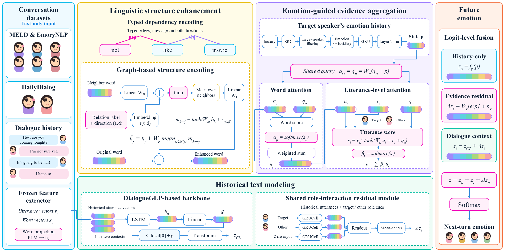

# SEES: Syntax and Emotion-Guided Evidence Selection

Research code for **future emotion inference in conversation** on MELD, DailyDialog,
and EmoryNLP. Given observed dialogue history and the target speaker, SEES predicts
the emotion of the next turn. The future utterance is excluded from model inputs.

**Status:** source release candidate, prepared for author review. This repository
does not claim an accepted publication or a complete downloadable data/checkpoint
release. The original experiment sources are preserved to retain provenance checks.



## Method

SEES combines dialogue context and role interaction with the target speaker's
predicted emotion history. That history conditions word- and utterance-level
evidence aggregation; typed dependency messages enrich the word representations.
The final prediction combines dialogue-context, historical-emotion, and evidence
logits. The fixed main configuration is **G2 + typed** (`G2__dep_typed`).

The ablations vary emotion-conditioning placement (G1, G_word, G2), linguistic
structure (none, untyped/typed dependencies, local negation, joint encoding),
relation-label assignment, and the entire evidence pathway. These configurations
are reported separately; they do not replace SEES dataset by dataset.
See [model names and controls](docs/MODEL.md).

GLP-text and DialogInfer-S are adapted comparison systems. In the code and run
records, DialogInfer-S is named `DialogInfer-S-adapted`. They share the prediction
instances and target with SEES, while features and optimization differ; SEES also
uses predicted historical emotion labels.

## Repository layout

| Path | Contents |
| --- | --- |
| `runtime/formal_model/` | Model, structure, historical-emotion and feature components |
| `runtime/nc_revision/` | Experimental trainers, model variants and evaluator |
| `runtime/evidence_control_v2/` | Matched full/no-evidence retraining and evaluation |
| `runtime/glp/aligned/` | Aligned GLP baseline support |
| `runtime/recovery/` | Protocol validation and test-feature preparation |
| `runtime/baselines/DialogueGLP/` | Reused upstream model source and MIT license |
| `scripts/` | Existing experiment runners plus release verification |
| `results/` | Numeric results with source labels; no raw dialogue text |
| `provenance/` | Source hashes and external asset inventory |
| `docs/` | Reproduction, data, result interpretation and release notes |

## Environment

The recorded experiments used Windows, Python 3.11, and NVIDIA GPUs. Linux
end-to-end training has not been verified; several launchers explicitly require
Windows. Install a PyTorch CUDA build appropriate for the GPU and driver using
the [official selector](https://pytorch.org/get-started/locally/), then install:

```cmd
conda create -n sees python=3.11 -y
conda activate sees
python -m pip install -r requirements.txt
```

The requirements file does **not** install PyTorch. The DailyDialog matched run
recorded PyTorch `2.11.0+cu130` on RTX 4060 Ti; this is a recorded environment,
not a guarantee for every machine. See [reproduction](docs/REPRODUCING.md).

## Check the source package

Run from the repository root:

```cmd
python scripts/verify_release.py
python scripts/check_cpu.py --root runtime
```

The first command checks source hashes, Python syntax, and result counts with the
standard library. The second performs existing CPU tensor checks and requires
PyTorch. Neither command trains a model or verifies scientific efficacy.

## Data and execution

Read [data and assets](docs/DATA.md) before training. This source package excludes
datasets, model weights, feature caches, and personal run logs. Its runners use
prepared experiment assets and are **not yet a one-command raw-data reproduction**.

With the documented assets restored under `runtime/`, the matched control uses:

```cmd
python scripts/no_evidence_control.py --root runtime --stage install --execute
python scripts/no_evidence_control.py --root runtime --stage probe --datasets dailydialog --execute
python scripts/no_evidence_control.py --root runtime --stage train --datasets dailydialog --execute
python scripts/no_evidence_control.py --root runtime --stage test --datasets dailydialog --execute
```

Use `meld` or `emorynlp` for the other datasets. Training covers seeds 1008, 42,
and 43 for both arms. Test evaluation uses validation-selected checkpoints.
See [all experiment commands](docs/REPRODUCING.md) for baselines and ablations.

## Main results

Test mean ± sample standard deviation over seeds 1008, 42, and 43, on a 0–100
scale. For each run, the checkpoint is selected by validation weighted-F1;
macro-F1 is measured at the same checkpoint. Values follow the 2026-11-02
manuscript supplied by the authors.

| Dataset | Configuration | Weighted-F1 | Macro-F1 |
| --- | --- | ---: | ---: |
| MELD | GLP-text | 37.28 ± 0.53 | 19.53 ± 0.84 |
| MELD | DialogInfer-S | 37.13 ± 0.95 | 17.82 ± 0.64 |
| MELD | SEES | 38.04 ± 0.76 | 18.71 ± 0.51 |
| DailyDialog | GLP-text | 73.09 ± 1.06 | 30.03 ± 4.73 |
| DailyDialog | DialogInfer-S | 72.53 ± 1.05 | 31.04 ± 0.38 |
| DailyDialog | SEES | 73.74 ± 0.82 | 28.34 ± 0.48 |
| EmoryNLP | GLP-text | 20.15 ± 0.88 | 16.01 ± 0.93 |
| EmoryNLP | DialogInfer-S | 23.46 ± 1.27 | 19.99 ± 1.64 |
| EmoryNLP | SEES | 22.29 ± 0.56 | 18.62 ± 0.60 |

SEES has the highest weighted-F1 among these three systems on MELD and
DailyDialog. DialogInfer-S scores higher on EmoryNLP, and SEES does not lead
macro-F1 on any of the three datasets. These are mean comparisons, not claims
of statistically significant superiority.

[Paper tables](results/manuscript/README.md) include the main results, ablations,
per-seed results, development selection, and class-level analysis.
The full/no-evidence control uses a **separate matched-retraining collection**;
its full-model values must not be substituted into this main table.
See [result interpretation and provenance](docs/RESULTS.md).

## Attribution and citation

We reuse code from [DialogueGLP](https://github.com/Reason-Wang/DialogueGLP).
Its license is retained alongside that source. See [third-party notices](THIRD_PARTY_NOTICES.md).
The author list and final paper URL will be added once confirmed; no publication
venue or DOI is asserted in this draft. Licensing of the authors' new code remains
to be finalized before public release; no repository-wide MIT grant is implied.
